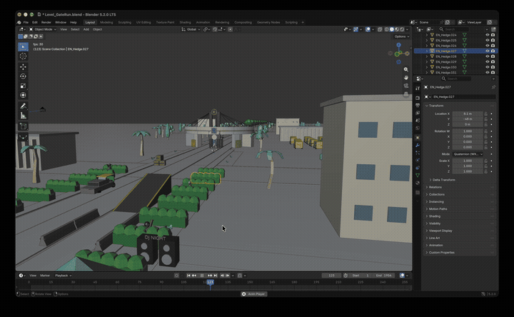

# OAU Run

A small, fast 3D driving game in the browser. Start at the main gate of Obafemi Awolowo
University, Ile-Ife, get in the car, and drive. Built with three.js and Blender. No install,
no engine download: the whole game is a few MB.

> Fan project. Not affiliated with Obafemi Awolowo University, Tesla or SpaceX.

## The gate jump



[Watch the full-quality video](docs/media/gate-jump.mp4)

## Run it

You need any static file server. From the repo root:

```bash
cd game
python3 -m http.server 8000
```

Open http://localhost:8000

## Controls

| Key | Action |
|---|---|
| W / Up | Gas |
| S / Down | Brake, then reverse |
| A D / Left Right | Steer |
| Shift | Boost |
| Space | Handbrake |
| R | Reset car |
| Enter | Skip the intro |
| P | Replay the intro |
| O | Free-look camera (drag to rotate) |

## What is in it

- The OAU main gate, modelled in Blender and exported as a 370 KB glTF.
- An intro: a person walks up, opens the door, and gets in.
- Arcade driving with a chase camera, spinning and steering wheels, and a road that runs
  about 1.6 km.
- Everything loads as small Draco-compressed glTF files.

## Project layout

```
game/               The web game (index.html, main.js, vendored three.js, assets/)
blender/
  gate/             OAU main gate: .blend, build scripts, glTF/FBX exports, textures
  level/            Full level scene (Level_GateRun.blend) and the scripts that build it
  student-union/    Students' Union building
  road-obstacles/   Road props
  rocket-roadster/  Rocket package model
  game-assets/      Shared asset master file and notes
docs/               Design notes
tools/              Helper scripts (Draco conversion)
```

## Blender files

Open any `*_master.blend` in Blender 4.x or newer (made with 5.2). Models are built by the Python
scripts in each `build/` folder, so they can be regenerated:

```bash
blender -b -P blender/gate/build/02_blockout.py
```

Exports used by the game live in each folder's `exports/`.

## Using your own car

The car model from development is not shipped (no license). The game uses a placeholder car
unless you add `game/assets/car_chassis.glb` and `game/assets/car_wheel.glb`.

## Contributing

Issues and pull requests are welcome. Please keep the game light: prefer compressed glTF and
small textures.

## License

MIT, see [LICENSE](LICENSE). Third-party assets are listed in [CREDITS.md](CREDITS.md).
